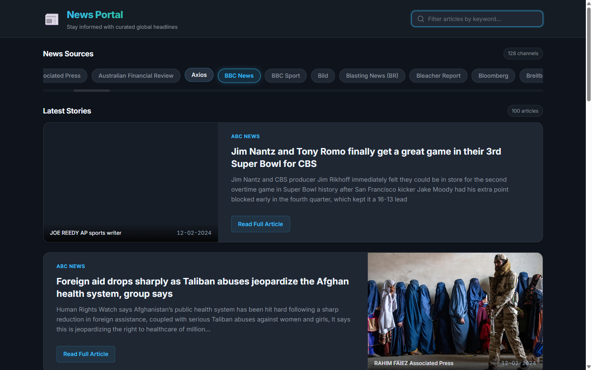

1. **Task:** [News API FullStack](https://github.com/rolling-scopes-school/tasks/blob/master/fullstack-engineering/tasks/TS-news-api/migration-newip-to-ts.md)
2. **Screenshot:**

   

3. **Deploy:** [https://xdobriev.github.io/news-JS/](https://xdobriev.github.io/news-JS/)
4. **Done:** 02.11.2026
5. **Score:** 170 / 170

## Описание выполненной работы

- Выполнена полная миграция приложения News API с JavaScript на строго типизированный TypeScript.
- Webpack настроен для работы с TypeScript через `ts-loader` и расширения `.ts`.
- Подключен ESLint с плагинами `@typescript-eslint/parser`, `@typescript-eslint/eslint-plugin`, пресетом `typescript-eslint/recommended`.
- Использование типа `any` полностью запрещено правилом `@typescript-eslint/no-explicit-any: error` и исключено из всего кода приложения (0 вхождений).
- В `tsconfig.json` включены обязательные строгие флаги `"strict": true` и `"noImplicitAny": true`.
- В кодовой базе применены все требуемые концепции TypeScript:
  - **Enums**: `HttpMethod`, `Endpoint`, `HttpStatus`.
  - **Generics**: обобщенные методы `getResp<T>`, `load<T>`, типы `Callback<T>`, `Nullable<T>`.
  - **Interfaces**: `NewsSource`, `NewsArticle`, `SourcesApiResponse`, `EverythingApiResponse`, `ApiRequest`.
  - **Utility Types**: `Pick` (`Pick<NewsSource, 'id' | 'name'>`), `Partial` (`Partial<Record<string, string | number>>`), `Readonly` (`Readonly<NewsArticle>`), `ReadonlyArray`.
  - **Access Modifiers**: `public`, `private`, `protected`, `readonly` на всех классах (`Loader`, `AppLoader`, `AppController`, `AppView`, `News`, `Sources`, `App`).
  - **Union Types**: объединения типов данных, статусов ответа и параметров запросов.
- Реализована адаптивная и отзывчивая вёрстка от `320px` до `1920px` с CSS-переменными, темной темой, гибкими карточками и горизонтальной прокруткой источников.
- Дополнительные улучшения UX:
  - Живой поиск/фильтрация статей по ключевым словам.
  - Индикация активного источника с авто-скроллом выбранного таба.
  - Спиннер загрузки, карточка ошибки и обработка пустых состояний.
  - Поддержка выбора источников с клавиатуры (`Enter` / `Space`).
  - Векторная офлайн-заглушка изображений (SVG Data URI) без внешних сетевых зависимостей.
- Футер содержит ссылку на GitHub автора, год создания (2024) и логотип RS School со ссылкой на курс.

---

## Самооценка (170 / 170 баллов)

### 1. Repository Setup — 40 / 40
- [x] **(20 баллов)** Pull Request создан в соответствии с требованиями курса (из ветки разработки `news-api` в `main` своего форка).
- [x] **(20 баллов)** История коммитов отражает процесс разработки, сообщения оформлены по [Commit Convention](https://rs.school/docs/git-convention) (`feat:`, `chore:`, `refactor:`, `docs:`, `fix:`).

### 2. Code Quality & TypeScript Migration — 100 / 100
- [x] **(50 баллов)** Приложение полностью переведено на TypeScript:
  - [x] **(10 баллов)** Everyday Types и Enums (`HttpMethod`, `Endpoint`, `HttpStatus`).
  - [x] **(10 баллов)** Generics (`getResp<T>`, `load<T>`, `Callback<T>`).
  - [x] **(10 баллов)** Object Types & Interfaces (`NewsSource`, `NewsArticle`, `SourcesApiResponse`, `EverythingApiResponse`).
  - [x] **(10 баллов)** Классы и модификаторы доступа (`private`, `public`, `protected`, `readonly`) во всех классах.
  - [x] **(10 баллов)** Function Types и сигнатуры колбэков.
- [x] **(10 баллов)** ESLint настроен для TypeScript, правило `no-explicit-any` включено, 0 ошибок.
- [x] **(10 баллов)** Тип `any` нигде не используется в проекте.
- [x] **(20 баллов)** В файле конфигурации TypeScript (`tsconfig.json`) установлены обязательные флаги `"noImplicitAny": true` и `"strict": true`.
- [x] **(10 баллов)** Webpack настроен для работы с TypeScript (`ts-loader`, расширения `['.ts', '.js']`).

### 3. Design and Application Functionality — 30 / 30
- [x] **(10 баллов)** Адаптивная верстка (`320px` - `1920px`).
- [x] **(20 баллов)** Улучшенный дизайн и функционал: живой поиск статей, подсветка активного источника, лоадер, экран ошибки, автономный SVG-плейсхолдер, доступность с клавиатуры.

**Итого: 170 / 170**
